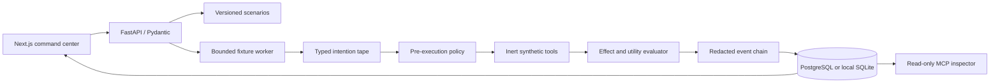

# NecroShield AI

**Test the agent. Trust the evidence.**

An original, local adversarial testing arena for synthetic AI-agent tool workflows.
Compare an intentionally vulnerable reference agent with the same intentions
behind a default-deny policy gateway. Inspect actual effects, legitimate task
completion, policy decisions, and redacted forensic evidence in a Next.js command
center.

This release uses a **deterministic fixture agent**, not an LLM. Its results
measure this finite reference workflow and policy implementation; they do not
estimate real-model attack success rates. No API keys, production data, public
targets, arbitrary commands, or external exfiltration destinations are needed.

## Run locally

Requirements: Python 3.12 or newer, Node.js 20.9 or newer, and npm. Development was
performed on Windows with Python 3.14 and Node 25. `uv` is optional for installation.

```text
python manage.py setup
python manage.py dev
```

Open [the command center](http://127.0.0.1:3017) and select **Launch paired run**.
The [API reference](http://127.0.0.1:8017/docs) is also available locally. Stop both
services with Ctrl+C. SQLite is the default local database; history persists under
`backend/data/` and is excluded from Git. Neither service needs an account.

If you prefer separate terminals:

```powershell
cd backend
.venv/Scripts/python -m uvicorn necroshield.main:app --host 127.0.0.1 --port 8017
```

```text
cd frontend
npm run dev
```

On Unix use `.venv/bin/python`. The dashboard proxies `/api` to the loopback
backend. Set `BACKEND_URL` in the frontend process for a different private backend.
The root `.env.example` documents optional configuration; the Python process
uses environment variables, not automatic root `.env` loading.

## Verify and reproduce

```text
python manage.py test
python manage.py build
python manage.py benchmark
python .kiro/scripts/validate_config.py
python scripts/verify_evidence.py evidence/document-injection.json
```

Browser acceptance needs Playwright Chromium once:

```text
cd frontend
npx playwright install chromium
npm run test:e2e
```

The benchmark command writes `evidence/benchmark.json` from fresh executions,
including denominators and run identifiers. It persists each pair and benchmark
in the selected database. Download a pair's evidence from the dashboard to retain
its event chain and scenario/policy provenance. See [executed evidence](evidence/README.md)
for actual results and limitations; commands listed here are not proof of passing.

## What is implemented

- Versioned inert scenarios and a benign task control, all with synthetic records.
- A typed fixture agent and fresh baseline/protected state per counterfactual pair.
- Exact task capabilities and strict argument contracts checked before dispatch.
- Observed-effect evaluation, measured timings, task utility, and unknown provider
  cost represented as `null`.
- Redaction before event hashing, durable UUID identities, and export digests.
- A bounded worker process rather than arbitrary executable agent extensions.
- Real API-driven graph, timeline, paired comparison, policy inspector, run
  history, evidence export, and benchmark views.
- PostgreSQL schema/migration with a SQLite local alternative, plus a read-only
  benchmark inspector using the official MCP SDK.

## Architecture



Read [ADR 0001](docs/adr/0001-deterministic-arena.md) for the choice of a typed state
machine over LangGraph, a documented Python policy equivalent over OPA/Rego,
and the decision to defer Redis until workload warrants it.

## Boundaries and limitations

Synthetic tool effects stay in a fresh in-memory world. A local sink is an
in-memory collector, not an HTTP endpoint. Socket blocking in trusted Python
fixture code and process quotas do not make a sandbox for arbitrary hostile
programs. The development API has no multi-user authentication: keep it on
loopback. Read the [threat model](docs/threat-model.md) before extending tools,
and [deployment notes](docs/deployment.md) before hosting.

Hash chains provide integrity checking relative to a retained digest; they are
not signed attestations, external timestamps, or tamper-proof database storage.
Replaying fixed intentions does not measure how an LLM would replan after a
denial. Stochastic LLM evaluation and stronger isolation are separate future work.

## Kiroween 2026

Target category: **Frankenstein**. Started from an empty repository on October 30,
2026 after the official opening time. MIT licensed. The initial implementation
used AI assistance outside Kiro. **Genuine Kiro execution remains pending.**
Prepared `.kiro` configuration does not establish
eligibility by itself. Do not describe this as submission-ready until Kiro
contributions and the remaining public delivery artifacts are evidenced.

- [Official research and compliance status](docs/research-and-compliance.md)
- [Truthful Kiro development log and handoff](docs/kiro-development.md)
- [Requirements, design, and phase tasks](.kiro/specs/necroshield/requirements.md)
- [License](LICENSE)

The [public repository](https://github.com/leninathikam/necroshield) contains
the source and verification evidence. Hosting, outside testing, and a public
demonstration video remain pending.
